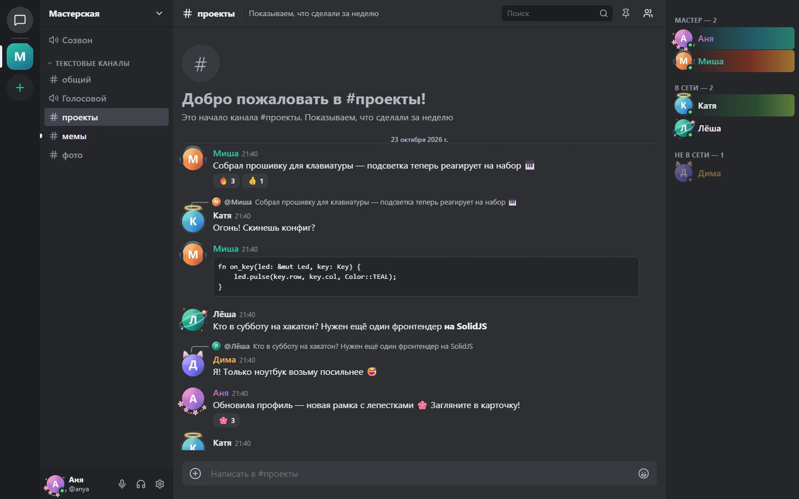
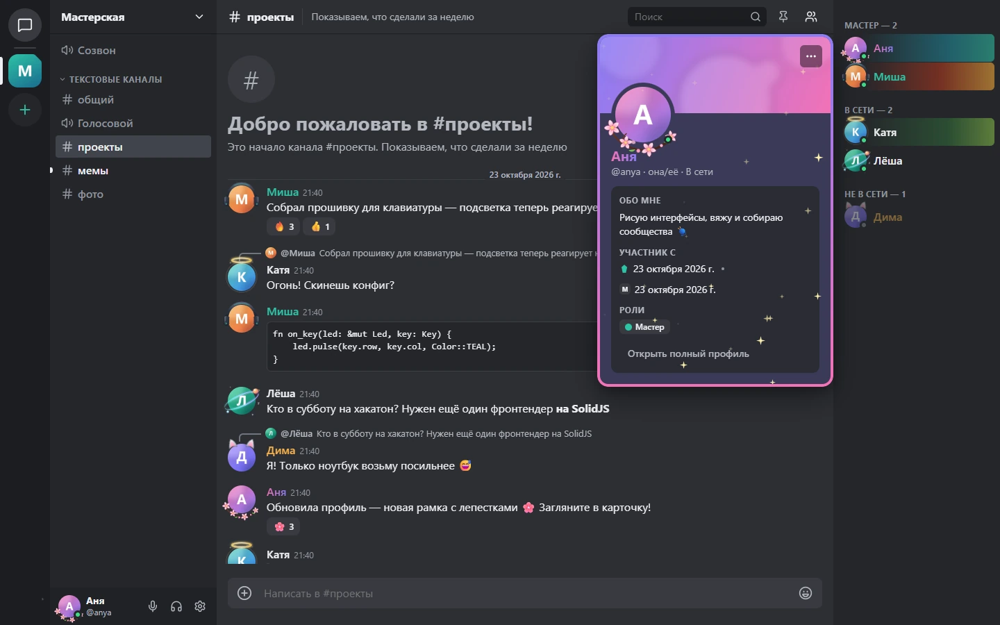
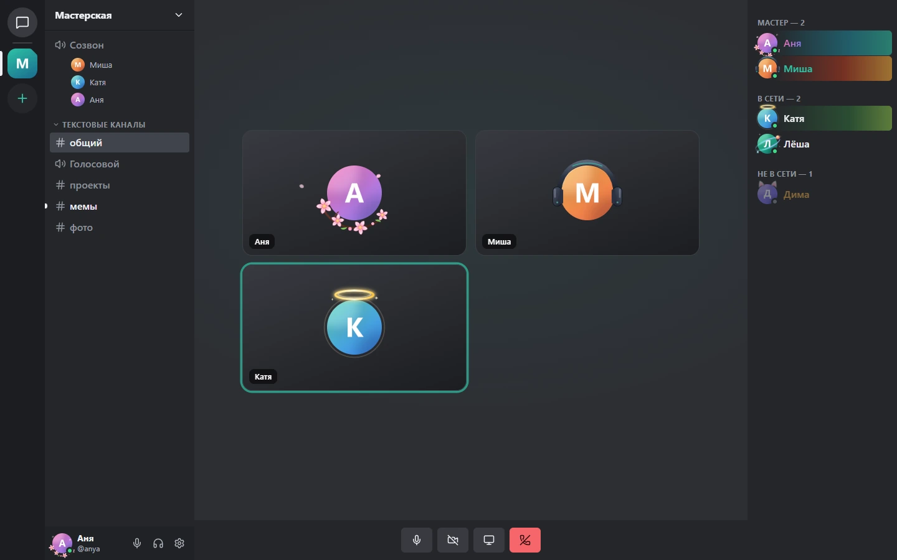
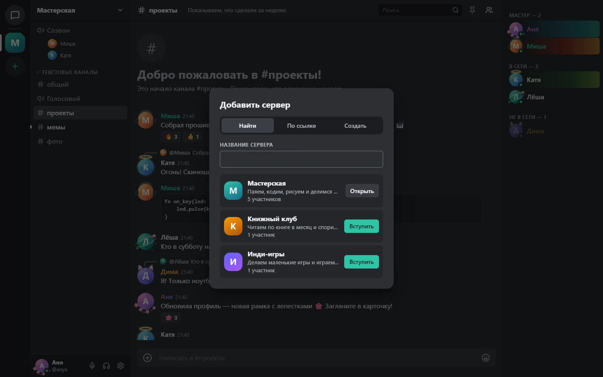
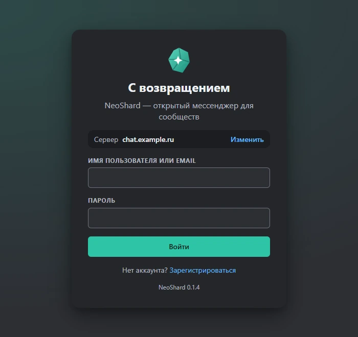
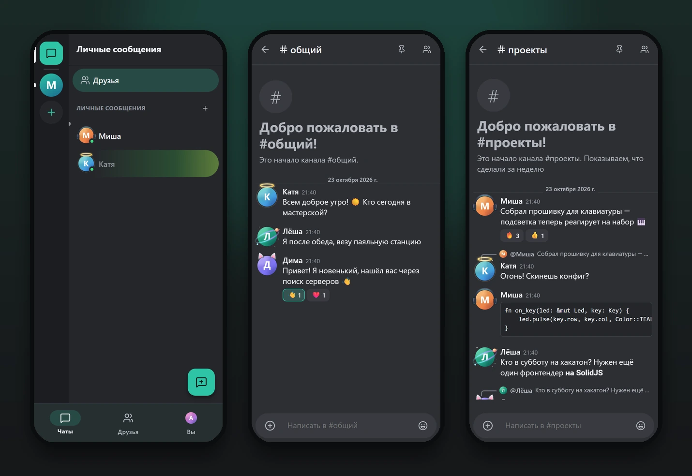

<div align="center">


# NeoShard

**Открытый мессенджер для сообществ — без центрального сервера.**
Серверы и каналы, голос и видео, звонки, шифрованные личные сообщения.
Свой сервер поднимается одной командой.

[](https://github.com/XPprojects-inc/neoshard/actions/workflows/ci.yml)
[](https://github.com/XPprojects-inc/neoshard/actions/workflows/standalone.yml)
[](LICENSE)

[Свой сервер](#свой-сервер-одной-командой) · [Скачать клиенты](https://github.com/XPprojects-inc/neoshard/releases/latest) · [Возможности](#возможности) · [Разработка](#разработка)



</div>

## Почему NeoShard

<table>
<tr>
<td width="33%" valign="top">

### 🌐 Нет центрального сервера

Каждый сервер NeoShard принадлежит тому, кто его поднял: семье, клубу, компании.
Нет единой точки, которую можно выключить, заблокировать или продать вместе с
вашими данными.

</td>
<td width="33%" valign="top">

### 📖 Полностью открытый код

Сервер, клиенты, протокол и даже этот пингвин — здесь, под GPL/AGPL. Никакой
сторонней аналитики и закрытых «облачных» частей.

</td>
<td width="33%" valign="top">

### 🎁 Полностью бесплатно

Никаких подписок, платных уровней и рекламы. Рамки для аватаров, эффекты профиля,
темы, большие сообщества — для всех.

</td>
</tr>
</table>

А ещё:
- **сквозное шифрование** личных и групповых бесед (MLS), включая файлы;
- **голос, видео и демонстрация экрана** через свой медиасервер (LiveKit);
- **лёгкие клиенты**: веб, Windows и Android; одно ядро на Rust для всех платформ.

## Как это выглядит

<table>
<tr>
<td></td>
<td></td>
</tr>
<tr>
<td align="center">Профили: баннер, рамки, эффекты, стили имени — бесплатно</td>
<td align="center">Голосовые каналы и звонки в ЛС</td>
</tr>
<tr>
<td></td>
<td></td>
</tr>
<tr>
<td align="center">Публичные серверы можно найти по названию</td>
<td align="center">Сервер выбирается при входе — свой или друзей</td>
</tr>
</table>



<p align="center">На телефоне — отдельная Material-раскладка</p>

> Скриншоты сняты с настоящего сервера NeoShard, запущенного локально, на демо-данных
> с вымышленными людьми.

## Свой сервер одной командой

Нужен только Docker:

```bash
git clone https://github.com/XPprojects-inc/neoshard.git
cd neoshard
docker compose up -d
```

Откройте **http://localhost**: там сайт сервера, а веб-клиент — на `/app/`.
Зарегистрируйтесь, создайте сервер и пригласите друзей ссылкой.

На своём домене с автоматическим HTTPS (Let's Encrypt). A-запись домена должна
указывать на эту машину:

```bash
NEOSHARD_DOMAIN=chat.example.com docker compose up -d
```

| что | как |
|---|---|
| Порты | 80 и 443 — сайт, клиент и API; 7880 — сигналинг голоса; 7881/tcp и 7882/udp — медиа |
| Данные | тома Docker: база, файлы, сертификаты. Резервная копия — `docker compose exec postgres pg_dump -U neoshard neoshard > backup.sql` |
| Секреты | генерируются при первом запуске и не покидают машину |
| Обновление | `git pull && docker compose pull && docker compose up -d` |
| Порт 80 занят | `NEOSHARD_HTTP_PORT=8080 docker compose up -d` |
| Закрыть регистрацию | `NEOSHARD_REGISTRATION_OPEN=false docker compose up -d` |

Это **автономный сервер**: он ни с кем не синхронизируется, вся переписка остаётся
у вас. Готовые образы собираются в GitHub Actions; если образа нет, Docker соберёт
его из исходников (~20 минут). Вариант для большой нагрузки (S3, NATS, TURN,
мониторинг, Helm) — в [`docs/deploy.md`](docs/deploy.md).

## Клиенты

| | |
|---|---|
| **Браузер** | `https://ваш-сервер/app/` — без установки |
| **Windows** | установщик в [релизах](https://github.com/XPprojects-inc/neoshard/releases/latest) |
| **Android** | APK в [релизах](https://github.com/XPprojects-inc/neoshard/releases/latest) |

В приложениях адрес сервера вводится на экране входа: «Сервер → Изменить».
APK в релизах подписан ключом сборки проекта, а не ключом магазина приложений: Android
попросит разрешить установку из этого источника. Собрать клиенты самому —
[`apps/android/README.md`](apps/android/README.md).

## Возможности

- **Сообщества:** серверы, категории и каналы (текст, голос, объявления, форумы,
  треды), роли с цветами и тонкими правами, приглашения, публичные серверы с поиском
  по названию, автомодерация, журнал аудита, баны и тайм-ауты.
- **Сообщения:** Markdown, ответы, реакции, закрепы, вложения с превью, стикеры,
  свои эмодзи, поиск с фильтрами, упоминания, непрочитанное, офлайн-очередь отправки.
- **Личное общение:** друзья по имени пользователя, ЛС и групповые чаты, звонки,
  блокировки, сквозное шифрование (MLS) с файлами.
- **Голос и видео:** голосовые каналы, камера, демонстрация экрана, шумоподавление.
- **Профили:** баннер, цвета, рамки аватаров, эффекты, таблички, стили имени, статусы.
- **Для разработчиков:** боты, вебхуки, слэш-команды, открытый протокол
  (protobuf + OpenAPI + AsyncAPI в [`spec/`](spec)), клиент на Python только по спецификации.

## Разработка

Нужны Rust ≥ 1.88, Node ≥ 20, PostgreSQL ≥ 17.

```bash
createuser -s neoshard && createdb -O neoshard neoshard   # пароль neoshard, см. scripts/dev-server.sh
bash scripts/dev-server.sh            # API и gateway на :8080, миграции применяются при старте
npm install && npm run proto && npm run wasm
npm run dev                           # веб-клиент на http://127.0.0.1:5173
```

Тесты: `cargo test --workspace` (интеграционные тесты поднимают живой сервер на
отдельной базе, нужен `DATABASE_URL`) и `npm test`. Правила — в
[`CONTRIBUTING.md`](CONTRIBUTING.md), свой форк — в [`FORKING.md`](FORKING.md).

```
server/                  сервер: axum + tokio — API, gateway, presence, медиа, федерация (AGPL-3.0)
crates/neoshard-core     ядро клиента на Rust: протокол, офлайн-кэш, E2EE → WASM, Tauri, Kotlin/Swift (GPL-3.0)
crates/neoshard-proto    протокол: protobuf-типы, права, snowflake
apps/web                 веб-клиент на SolidJS        apps/site     сайт сервера (с пингвином)
apps/desktop             десктоп (Tauri 2)            apps/android  Android (Tauri 2)
packages/ui              UI-кит, темы, анимации        spec/         протокол (CC-BY-4.0)
deploy/                  docker compose, Helm, Terraform, мониторинг
docs/                    решения (ADR), исследования, прогресс
```

Почему всё устроено именно так — в [`docs/adr/`](docs/adr), что готово и что
нет — в [`docs/PROGRESS.md`](docs/PROGRESS.md).

## English

NeoShard is an open-source community messenger with **no central server**: anyone
can run their own with `docker compose up -d`. Servers and channels, voice and video,
DM calls, end-to-end encrypted DMs (MLS), web/Windows/Android clients built on one
Rust core. Fully open source (GPL-3.0 / AGPL-3.0) and completely free — no
subscriptions, no ads, no third-party analytics. The interface is in Russian for now.

## Лицензии

Клиенты и ядро — GPL-3.0-or-later, сервер — AGPL-3.0-or-later, спецификация
протокола и бренд — CC-BY-4.0 ([`LICENSE`](LICENSE), тексты в [`LICENSES/`](LICENSES),
[ADR-0010](docs/adr/0010-licensing.md)). NeoShard — независимый проект и не связан
с другими мессенджерами; код, графика и бренд — собственные.
